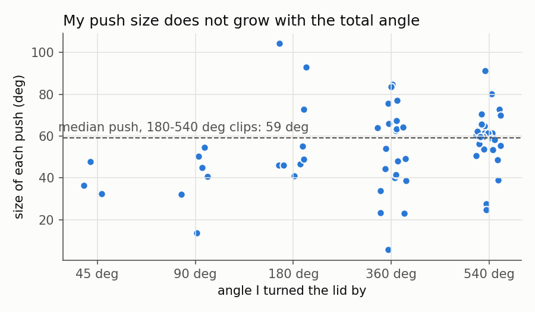
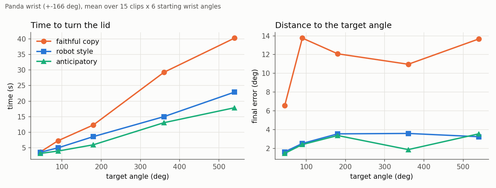
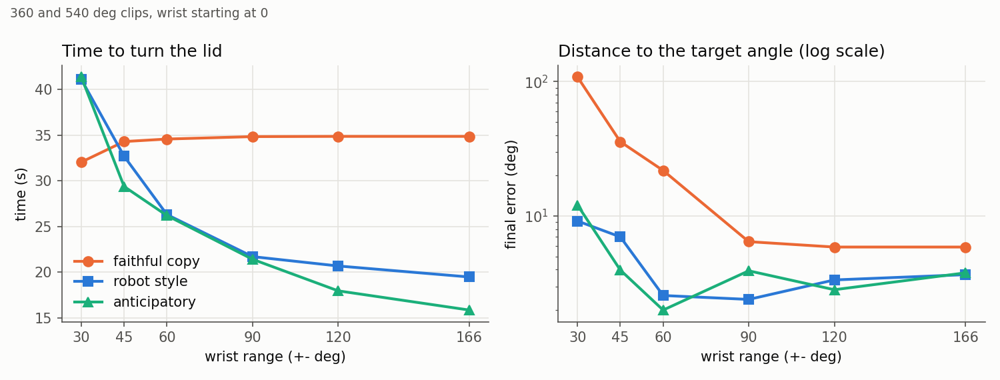
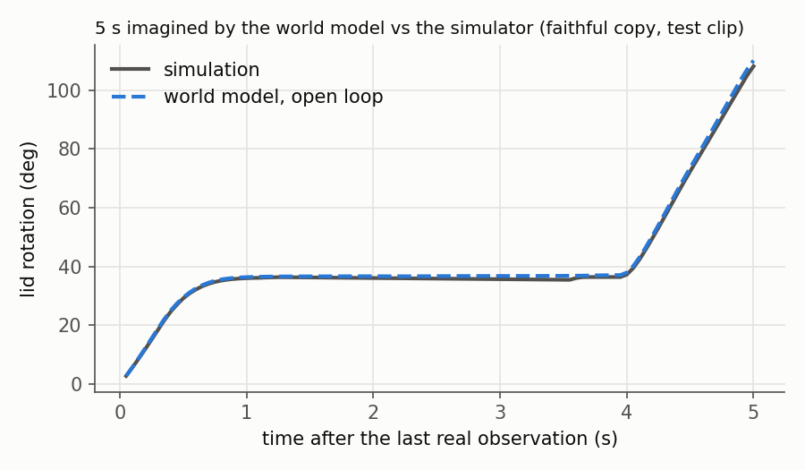

# Human to robot lid turning

I filmed my own hand turning a jar lid, measured how I do it, then compared on a simulated
Panda arm two ways of using that data: copying my strategy, or adapting it to the robot's body.



## 1. The question

My goal was to use my own video data to drive a simulated robot arm that turns a lid by a
given angle, for example for plumbing robots that have to open valves. While filming myself,
I discovered that I turn lids with one hand while holding the jar with the other, in several
small pushes of about 55 degrees made with my fingers, not my wrist. Then, reading the
documentation, I learned that the Panda's wrist turns up to +-166 degrees. That gave the main
question of this project: should the robot copy my strategy, or adapt it to its own body?

## 2. My data

I filmed myself turning the lid of a jar, with the phone fixed 50 cm above the table and
looking down, close to my own point of view. The jar stood on a cutting mat with a 5 cm grid,
centred with a cross drawn under it. A black line drawn across the lid was aligned with a line
of the mat at the start of every clip, which gives the 0 degree reference.

- 15 clips: 5 target angles (45, 90, 180, 360, 540 degrees), 3 takes each
- iPhone 13 mini, 0.5x lens, 1080p, 30 fps
- the videos are not in the repository; `data/pushes.csv` contains what I measured on them

## 3. Measuring the lid

**Try 1: the palm.** I measured the angle of the line between the base of the index and the
base of the little finger (MediaPipe hand landmarks 5 and 17). It failed: my palm barely
moves, because I turn the lid with my fingers.

**Try 2: thumb to index.** The line between the thumb tip and the index tip (landmarks 4 and
8) follows the lid better, but it lost 20 to 45% of the real rotation on clips with several
pushes. MediaPipe also lost my right hand on 5 of the 15 clips when my grip was closed.

**Try 3: the line on the lid.** I detect the lid on the first frame, keep the dark grey
pixels inside it (the drawn line), fit a straight line to them on every frame and follow its
angle over time (`measure_lid.py`). On the 90 to 540 degree clips, the final angle is within
3 degrees of the target. On the 45 degree clips it is 5 to 8 degrees off: I aimed at the mat
diagonal by eye, and these clips cannot tell my aim apart from a measurement error. It does
not need MediaPipe at all, so it also works on the clips where the hand was lost.

Once the angle was reliable, I cut each clip into pushes: a push is a stretch of frames where
the lid turns faster than 15 degrees/s, about 3 times the noise of a still lid and below my
slowest real push. That gives 67 pushes, with a median of 56 degrees (half of them between 45
and 64). The figure above shows that the size of my pushes does not grow with the total angle:
I just do more of them.

## 4. Simulation and the three strategies

I used robosuite (MuJoCo) with a Panda arm. I made two changes to the default setup:

- **A cylinder instead of a cube.** A cube can only be grasped in 4 orientations. In testing,
  after a regrasp of about 55 degrees, the gripper landed on a corner and missed. A cylinder
  can be grasped at any angle, like my lid.
- **Only the last joint turns.** With robosuite's default controller, the rotation was spread
  over the whole arm: the wrist moved 130 degrees while the lid turned 300. The +-166 degree
  wrist limit no longer meant anything. The arm now places the gripper above the lid, and
  only joint 7 (the wrist) turns it, so the limit is clear and measurable.

The robot has to turn the lid by the angle I turned it in each clip. Three strategies
(`strategies.py`):

1. **Faithful copy**: replays each of my pushes from the clip, with its size and speed, and
   lets go and regrasps after each one, like I did.
2. **Robot style**: keeps only my total angle. It turns as far as the wrist allows and
   regrasps only when it reaches the limit.
3. **Anticipatory**: before each grasp, it turns the open gripper back so that the whole
   stroke fits before the limit. This copies a principle and not a motion: people prepare
   their grasp for the movement that comes next (motor planning).

## 5. Results



**On the simulated Panda (+-166 degrees), copying me is the worst option.** It is about twice
as slow (40 s against 18 to 23 s for 540 degrees) because every regrasp costs the robot about
3 s (open, lift, turn back, go down, close) and it makes 6 to 10 of them where the other
strategies make 2 or 3. My fingers do the same in half a second. It is also the least
accurate (6 to 14 degrees off) because it replays my pushes without looking at the lid: it
misses the slow last degrees of a clip that were too slow to count as a push.

**My first test of the hypothesis was wrong.** I expected my strategy to win when the wrist
is limited like a human hand, and I tested it by changing the starting angle of the wrist.
But the starting angle only limits the first stroke: after one regrasp, the robot gets its
full range back. So I ran a second sweep that really limits the range of the wrist.



**With a limited wrist, my rhythm wins, but my pushes do not fit.** At +-30 degrees the
faithful copy becomes the fastest (32 s against 41 s), because my short and fast returns
cost less than the robot's. But my pushes, up to 100 degrees, do not fit in a 50 degree
stroke, so it ends more than 100 degrees short. Around +-45 degrees the times cross. What
transfers from my data is the rhythm, not the size of my movements.

**The anticipatory strategy has a cost.** It is the fastest on the real Panda range, but it
always ends with the wrist against its limit (0 degrees of room left), while the two others
keep about 160 degrees for whatever comes next.

Times are identical from one run to another, but final errors vary by about 2 degrees, so I
only compare errors when the difference is larger than that.

## 6. World model



`world_model.py` trains a small MLP (2 hidden layers of 64) on the step-by-step histories of
the 270 simulated episodes. Given the last 5 steps and the next command (wrist target, grip),
it predicts how much the lid and the wrist turn during the next step (1/20 s). Everything is
expressed as changes, so the model does not depend on absolute angles. Episodes from my third
take of each angle are kept for testing and never seen in training.

| error per step (deg) | lid | wrist |
|---|---|---|
| world model | 0.03 | 0.02 |
| baseline: next change = current change | 0.091 | 0.141 |

Left alone, feeding its own predictions back as inputs, the model stays within 0.7 degrees of
the simulator after 1 s and 2.5 degrees after 5 s, regrasps included (figure above).

## 7. How to run

Tested on Google Colab (Python 3.13).

```bash
pip install --only-binary=:all: robosuite "mujoco==3.3.0" torch matplotlib
# on Colab, restart the session after this install

python experiments.py      # the two sweeps (about 40 min on Colab CPU) -> results/
python world_model.py      # trains and evaluates the world model -> results/world_model.pt
python make_figures.py     # -> figures/
```

`measure_lid.py` needs my videos, which are not in the repository; its output is
`data/pushes.csv`. With your own clips named like `geste_360.01.MOV`:

```bash
pip install numpy opencv-python-headless
python measure_lid.py path/to/clips data/pushes.csv
```

| file | what it does |
|---|---|
| `measure_lid.py` | video -> lid angle -> pushes |
| `sim.py` | the Panda, the lid and the motion primitives (grasp, release, turn) |
| `strategies.py` | the three strategies |
| `experiments.py` | the two sweeps |
| `world_model.py` | the learned model and its evaluation |
| `make_figures.py` | the figures of this README |

## 8. Limitations and next steps

- Simulation only, and a cylinder instead of a real threaded lid.
- The speed of the open gripper going back is fixed at 180 degrees/s; I did not measure how
  fast my fingers reposition.
- Only my own hand was filmed.
- The world model is not yet used to choose a plan. The next step would be to score candidate
  plans in the model before running the best one in the simulator.
- A fourth strategy follows from the results: my rhythm with push sizes clipped to the wrist's
  range.

## 9. A note on tools

I used Claude (an AI assistant) throughout this project, to debug, to write much of the
simulation plumbing and the world model code, and to review my writing. I designed the
experiment, filmed and measured the data, wrote the measurement and strategy code, and
reviewed every file until I could explain it.
